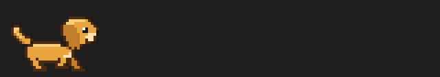

# mochi

A cozy pixel-art golden retriever puppy for [Claude Code](https://claude.com/claude-code). Mochi lives just above your prompt, wanders around, does the odd trick, naps, and reacts to what is happening in your session: curious while you type, thinking while Claude works, worried when things break and over the moon when they work out again.



Feed it, pet it, give it treats you earned. It never makes a sound and never interrupts you.

## Install

At the prompt of a Claude Code session:

```
/plugin install mochi --marketplace coenond/mochi
```

Answer `y` to add the marketplace, then press Enter for the user scope so Mochi follows you into every project. From a shell:

```bash
claude plugin install mochi --marketplace coenond/mochi
```

The band shows an empty basket until you adopt your pet.

## Looking after your pet

| Command                    | What it does                                                                            |
| -------------------------- | --------------------------------------------------------------------------------------- |
| `/pet adopt <name> [coat]` | Adopts your pet. Coats: `golden`, `light`, `red`. Leave it out to pick one in the band. |
| `/pet name <name>`         | Renames your pet.                                                                       |
| `/pet feed`                | Kibble, free and unlimited. A full pet says no.                                         |
| `/pet pet`                 | Petting.                                                                                |
| `/pet treat`               | Gives a treat you earned with a win (tests passing after they failed).                  |
| `/pet status`              | Name, coat, needs and treats saved.                                                     |

Beside the pet sit three dim controls: `♥` pet, `∴` feed and `✦` treat. Focus the band and press `p`, `f` or `t`, or click a glyph.

There is one pet per owner, shared by every project and session. Its hunger, happiness and energy drift while you are away, but it never falls ill or runs off.

## Settings

- **Model tone** (`modelTone`, off by default): Mochi reads the tone of what you write with local heuristics. Turn this on to have a small model read each prompt you send instead. Every call is billed to your Claude Code session and adds a short delay before Mochi reacts. When a call is not answered, Mochi falls back to the heuristics. Your draft is always read locally.

## Developing

Mochi is a Claude Code mod. Install the tools with `pnpm install`; that also sets up the pre-commit hook.

- `pnpm check`: typecheck, unit tests (Vitest, `src/**/*.spec.ts`) and formatting, as CI runs them.
- `pnpm test:plugin`: the engine tests (`claude plugin test`, `hooks/**/*.test.tsx`).
- `pnpm validate`: `claude plugin validate`.
- `claude --plugin-dir .`: a session with Mochi loaded, to see the band.

## License

MIT
